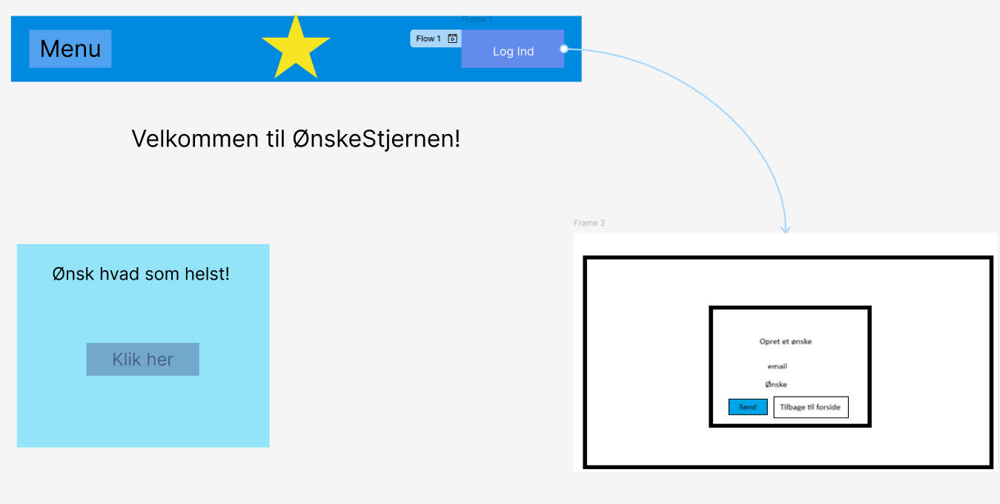
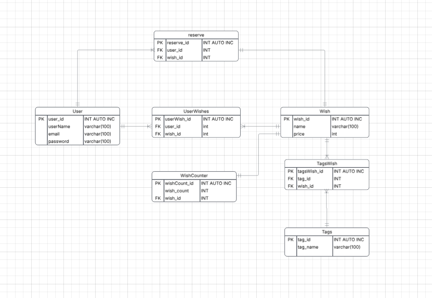
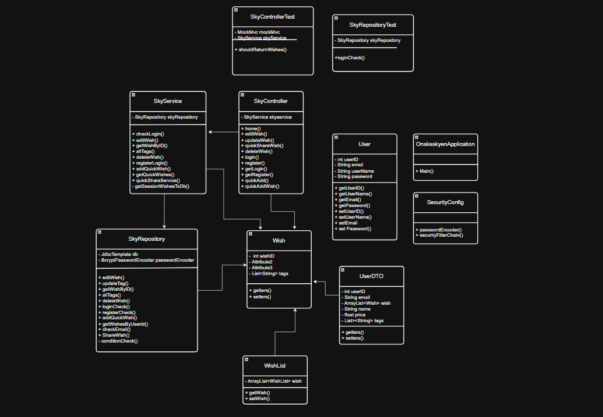

# Ønskestjernen

Ønskestjernen er en webapplikation, hvor brugere kan oprette deres digitale ønskeliste.
Formålet er at gøre det nemt at samle sine ønsker og dele dem med andre.

## Features

- Opret Ønsker med navn og pris
- Tilføj tags til ønsker
- Registere brugers email
- del ønskelister med andre
- login på sin bruger

## teknologier

- Java
- Spring boot
- thymeleaf
- SQL
- HTML
- CSS
- Bootstrap

## Installation

git clone: https://github.com/OnskeStjernen/-nskeSkyenRepo.git

## Brug

Når applikationen er startet, kan den åbnes i browseren på: http://localhost:8080

## Bidrag

Se CONTRIBUTING.md

## Prototype

## ER-model

## Klasse Diagram

